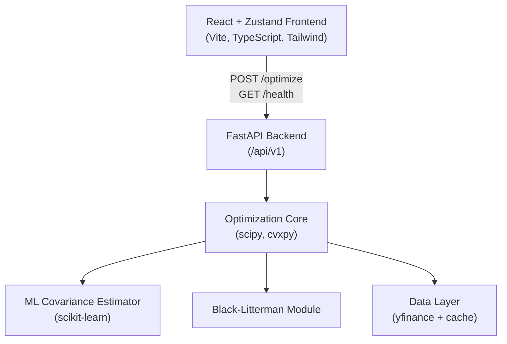

# Portfolio Optimization Engine

> A production-grade portfolio optimization platform that compares three strategies — Historical Mean-Variance, ML-Enhanced, and Black-Litterman — using modern risk metrics, an efficient frontier explorer, and a real-time React dashboard. Designed for quantitative analysts and sophisticated investors who want to go beyond simple buy-and-hold.

---

## Architecture Overview



---

## Prerequisites

- Python 3.10+
- Node.js ≥ 18
- pip

---

## Backend Setup

Run everything from the repository root (the app is imported as `backend.main`).

```bash
python -m venv venv
source venv/bin/activate          # Windows: venv\Scripts\activate
pip install -r requirements.txt
uvicorn backend.main:app --reload --port 8000
```

### Manual API tests

With the server running, the frontend team can verify the backend independently:

```bash
# Health check
curl http://localhost:8000/api/v1/health

# Optimize (stub — returns uniform weights)
curl -X POST http://localhost:8000/api/v1/optimize \
  -H "Content-Type: application/json" \
  -d '{
    "assets": ["AAPL","MSFT","NVDA","JPM","KO"],
    "start_date": "2022-01-01",
    "end_date": "2025-01-01",
    "method": "historical",
    "objective": "max_sharpe",
    "risk_free_rate": 0.05,
    "target_return": null,
    "bl_views": null
  }'
```

> `/optimize` downloads real prices from Yahoo Finance (cached in `CACHE_DIR`), so the first call needs internet access. Weights and metrics are stubs until Phase 2.

### Backend checks

```bash
black backend/ --check
isort backend/ --check-only
pytest backend/tests/ -v --cov=backend --cov-report=term-missing
python scripts/run_phase_1.py     # runs all backend + frontend checks
```

---

## Frontend Setup

```bash
cd portfolio-optimizer/frontend
npm install
cp .env.example .env      # set VITE_API_URL
npm run dev
```

---

## Environment Variables

| Variable | Default | Description |
|---|---|---|
| `RISK_FREE_RATE` | `0.05` | Annual risk-free rate used in Sharpe/Sortino |
| `CACHE_DIR` | `./data_cache` | Where yfinance data is cached |
| `PORT` | `8000` | FastAPI port |
| `VITE_API_URL` | `http://localhost:8000/api/v1` | Frontend API base URL |

---

## Phase Status

| Phase | Status | Owner |
|---|---|---|
| Phase 1 — Foundation | 🟡 In progress | Deep + Vedant |
| Phase 2 — Core Optimization | ⬜ Not started | Vedant |
| Phase 3 — ML Enhancement | ⬜ Not started | Vedant |
| Phase 4 — Black-Litterman | ⬜ Not started | Vedant |
| Phase 5 — Frontend Charts | ⬜ Not started | Deep |

---

## API Endpoints

| Method | Endpoint | Description |
|---|---|---|
| GET | `/api/v1/health` | Service health check |
| POST | `/api/v1/optimize` | Run portfolio optimization |

---

## Contributing

See `docs/RULES.md` before touching any file.
