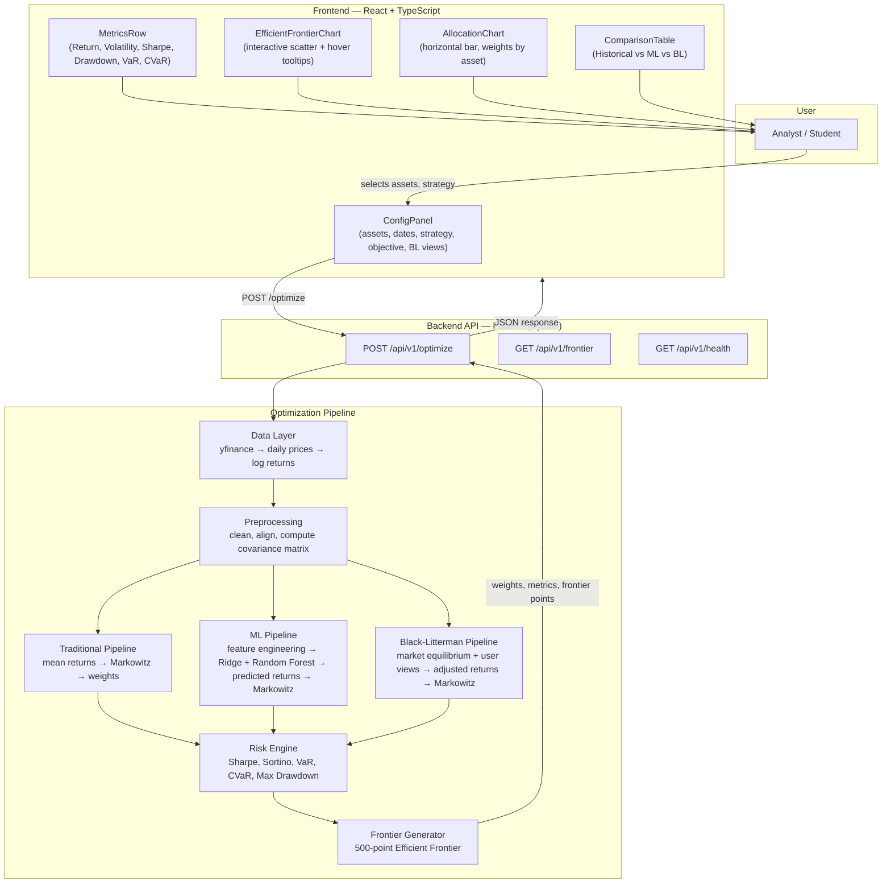
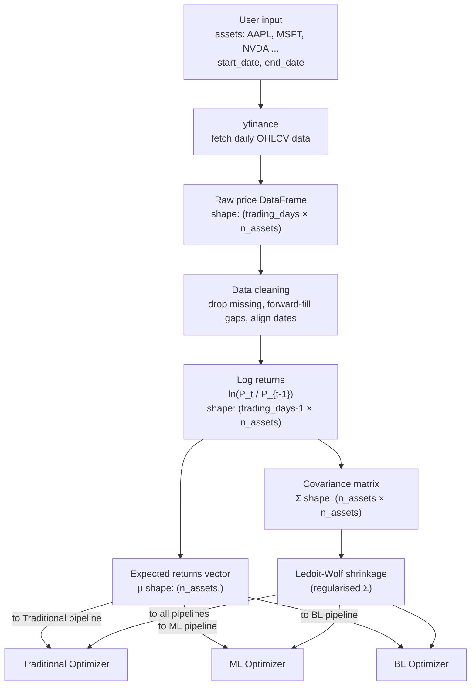
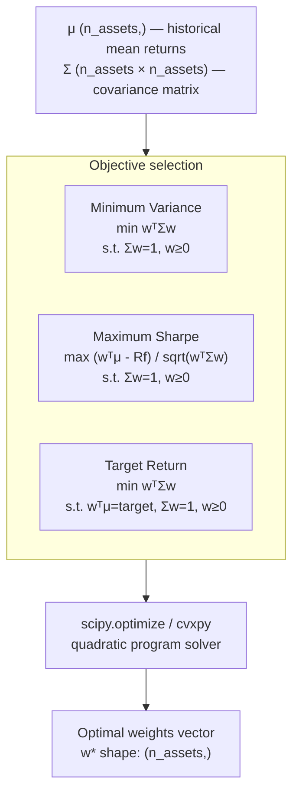
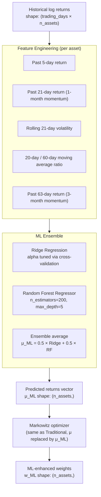
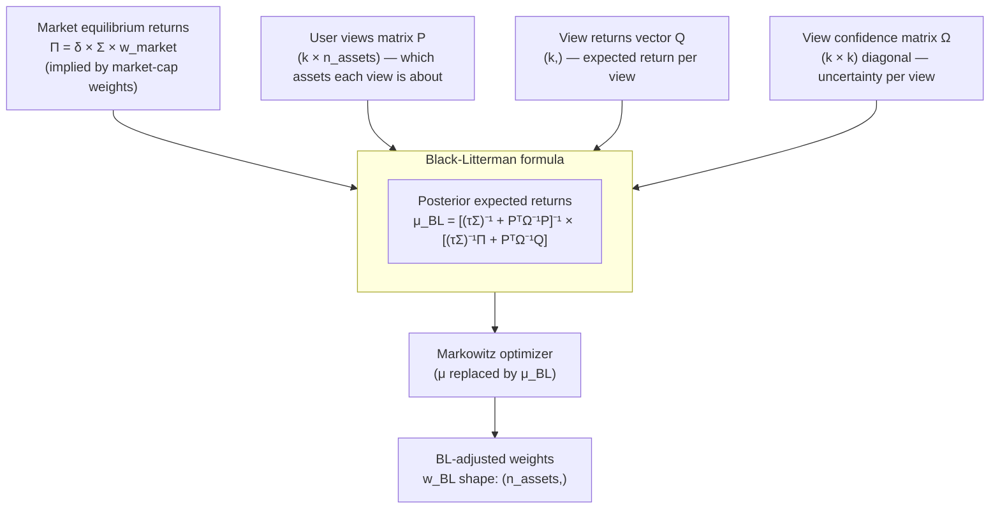
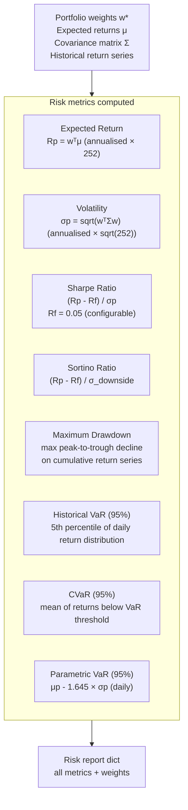
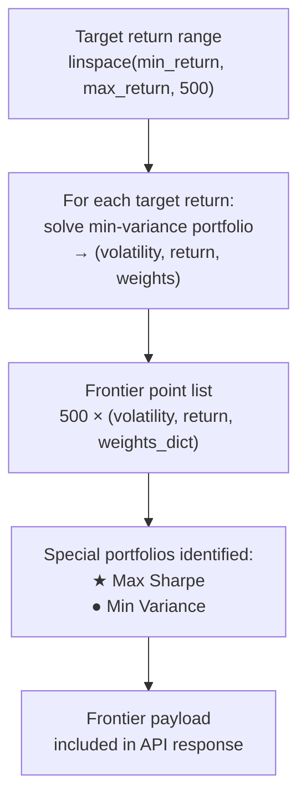

# Portfolio Optimization Engine — System Architecture

> Canonical reference for how the system is structured, how data flows, and why each technology was chosen.
> All diagrams use Mermaid syntax. ASCII art is not permitted per RULES.md §11.

---

## 1. System overview

A quantitative portfolio construction engine. The user selects assets, a date range, and an optimization strategy. The backend fetches historical market data, runs the selected optimization pipeline (Traditional Markowitz, ML-Enhanced, or Black-Litterman), and returns portfolio weights, risk metrics, and the full Efficient Frontier. The frontend renders everything interactively.



---

## 2. Data pipeline



---

## 3. Traditional Markowitz pipeline



---

## 4. ML-enhanced pipeline



---

## 5. Black-Litterman pipeline



---

## 6. Risk engine



---

## 7. Efficient Frontier generator



---

## 8. API contract

This is the agreed interface between Vedant's backend and Deep's frontend. Neither side changes this without telling the other.

### `POST /api/v1/optimize`

**Request:**
```json
{
  "assets": ["AAPL", "MSFT", "NVDA", "JPM", "XOM", "KO"],
  "start_date": "2022-01-01",
  "end_date": "2026-01-01",
  "method": "historical",
  "objective": "max_sharpe",
  "risk_free_rate": 0.05,
  "target_return": null,
  "bl_views": null
}
```

`method` options: `"historical"` | `"ml"` | `"bl"`
`objective` options: `"max_sharpe"` | `"min_variance"` | `"target_return"`

For Black-Litterman, `bl_views` shape:
```json
{
  "bl_views": [
    { "asset": "NVDA", "expected_return": 0.25, "confidence": 0.70 },
    { "asset": "KO",   "expected_return": 0.06, "confidence": 0.90 }
  ]
}
```

**Response:**
```json
{
  "success": true,
  "data": {
    "weights": {
      "AAPL": 0.22,
      "MSFT": 0.28,
      "NVDA": 0.12,
      "JPM":  0.16,
      "XOM":  0.10,
      "KO":   0.12
    },
    "metrics": {
      "expected_return": 0.147,
      "volatility":      0.112,
      "sharpe_ratio":    1.21,
      "sortino_ratio":   1.45,
      "max_drawdown":   -0.134,
      "var_95":         -0.028,
      "cvar_95":        -0.041,
      "var_95_parametric": -0.026
    },
    "frontier": [
      {
        "volatility": 0.089,
        "expected_return": 0.092,
        "sharpe": 0.47,
        "weights": { "AAPL": 0.10, "MSFT": 0.35, ... }
      }
    ],
    "method": "historical",
    "objective": "max_sharpe",
    "assets": ["AAPL", "MSFT", "NVDA", "JPM", "XOM", "KO"],
    "date_range": { "start": "2022-01-01", "end": "2026-01-01" }
  },
  "error": null
}
```

### `GET /api/v1/health`

**Response:**
```json
{
  "success": true,
  "data": {
    "status": "ok",
    "version": "0.1.0"
  },
  "error": null
}
```

### Error response shape (all endpoints)

```json
{
  "success": false,
  "data": null,
  "error": "Insufficient data: NVDA has fewer than 252 trading days in the selected range."
}
```

---

## 9. Repository structure

```
portfolio-optimizer/
├── backend/
│   ├── api/
│   │   └── routes.py              # FastAPI route handlers
│   ├── core/
│   │   ├── config.py              # Settings, constants, env vars
│   │   └── logger.py              # Logging setup
│   ├── data/
│   │   └── fetcher.py             # yfinance wrapper, caching
│   ├── optimization/
│   │   ├── markowitz.py           # Traditional optimizer
│   │   ├── ml_optimizer.py        # ML return forecasting + optimizer
│   │   ├── black_litterman.py     # BL model
│   │   └── frontier.py            # Efficient Frontier generator
│   ├── risk/
│   │   └── metrics.py             # All risk metric calculations
│   ├── tests/
│   │   ├── test_markowitz.py
│   │   ├── test_ml_optimizer.py
│   │   ├── test_black_litterman.py
│   │   ├── test_risk_metrics.py
│   │   └── test_api.py
│   └── main.py                    # FastAPI entry point
├── frontend/
│   ├── src/
│   │   ├── components/
│   │   │   ├── ConfigPanel/
│   │   │   ├── MetricsRow/
│   │   │   ├── EfficientFrontierChart/
│   │   │   ├── AllocationChart/
│   │   │   └── ComparisonTable/
│   │   ├── hooks/
│   │   │   └── useOptimize.ts     # Optimization API call + state
│   │   ├── store/
│   │   │   └── usePortfolioStore.ts
│   │   ├── services/
│   │   │   └── apiService.ts
│   │   ├── types/
│   │   │   └── index.ts
│   │   └── styles/
│   │       └── global.css
│   ├── public/
│   └── package.json
├── docs/
│   ├── RULES.md
│   ├── ARCHITECTURE.md            # This file
│   ├── DESIGN.md
│   └── phases/
│       ├── PHASE_1.md
│       ├── PHASE_1_BACKEND.md
│       └── ...
├── scripts/
│   ├── run_phase_1.py
│   └── run_all_phases.py
├── runs/                          # Phase status files — gitignored
├── .env.example
├── .gitignore
├── requirements.txt
└── README.md
```

---

## 10. Technology decisions

| Decision | Choice | Reason |
|---|---|---|
| Backend framework | FastAPI | Async, automatic OpenAPI docs, clean request/response typing |
| Data source | yfinance | Free, reliable, covers all required global equities |
| Optimization solver | scipy.optimize + cvxpy | scipy for speed on standard problems, cvxpy for constrained QP |
| Covariance estimation | Ledoit-Wolf shrinkage | More stable than sample covariance with < 5 years of data |
| ML models | Ridge Regression + Random Forest | Interpretable, low overfitting risk, fast to retrain |
| Frontend framework | React 18 | Component model suits the multi-panel dashboard |
| Charting library | Recharts | React-native, composable, hover interactions built-in |
| Frontend state | Zustand | Lightweight, no boilerplate, sufficient for this scale |
| Styling | Tailwind CSS | Enforces the design token system, no CSS file sprawl |
| Language (frontend) | TypeScript (strict) | Catches API contract mismatches at compile time |
